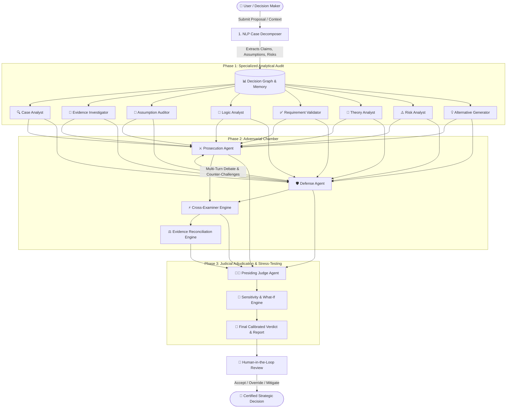

# ⚖️ Multi-Agent Decision Court (MADC)

<div align="center">

[](https://fastapi.tiangolo.com)
[](https://reactjs.org/)
[](https://www.typescriptlang.org/)
[](https://vitejs.dev/)
[](https://tailwindcss.com/)
[](https://www.python.org/)
[](https://opensource.org/licenses/MIT)

**An Autonomous Multi-Agent Judicial Reasoning & Decision Stress-Testing Platform**

*Adversarial Debate • Probabilistic Evidence Reconciliation • Logical Fallacy Detection • Calibrated Adjudication • What-If Stress Testing*

</div>

---

## 📖 Executive Summary

The **Multi-Agent Decision Court (MADC)** is an enterprise-grade AI deliberation platform designed to evaluate complex, high-stakes strategic and technical decisions. Rather than relying on naive single-prompt LLM responses or unconstrained majority voting, MADC deploys **11 specialized autonomous agents** structured like an adversarial judicial tribunal.

The system decomposes unstructured business memos and technical proposals into a typed **Decision Graph**, subjects proposals to adversarial cross-examination, audits hidden premises, identifies logical fallacies, reconciles conflicting benchmark data, and delivers a rigorous, calibrated judicial verdict backed by sensitivity analysis and human-in-the-loop governance.

---

## 🏛️ System Architecture



---

## 🌟 Key Capabilities & Features

### 🔍 1. Natural Language Decomposition (NLP)
- Ingests raw strategy memos, architectural proposals, or free-form text.
- Parses unstructured narrative into **Atomic Claims**, **Explicit/Implicit Assumptions**, **Constraints**, **Theories**, and **Risk Factors**.
- Ingests and indexes PDF, DOCX, and text benchmark reports into vector & keyword retrieval indexes.

### 🧠 2. 11 Specialized Autonomous Agents
| Agent | Responsibility | Core Metrics Evaluated |
| :--- | :--- | :--- |
| **🔍 Case Analyst** | Scope framing, boundary conditions & ambiguity detection | Semantic clarity, undefined variables |
| **📁 Evidence Investigator** | Verifies claim directness, reliability, and proof sources | Relevance (0-1), Evidence Strength (0-1) |
| **🧐 Assumption Auditor** | Discovers hidden premises and unverified dependencies | Fragility index, Criticality (0-1) |
| **🧩 Logic Analyst** | Audits reasoning chains for fallacies and inductive leaps | Deductive validity, Soundness score |
| **✅ Requirement Validator** | Evaluates compliance against hard budget/time constraints | Constraint compliance, Violation flags |
| **📐 Theory Analyst** | Tests domain scaling laws & architectural models | Precondition fit, Boundary limits |
| **⚠️ Risk Analyst** | Quantifies failure modes, hazards, and blast radius | Probability, Impact, Severity score |
| **💡 Alternative Generator** | Synthesizes viable competing options & tradeoff matrices | Feasibility vs Requirement fit |
| **⚔️ Prosecution Agent** | Challenges vulnerabilities, hidden costs & downside risks | Attack strength, Counter-evidence |
| **🛡️ Defense Agent** | Advocates value proposition, mitigations & safety margins | Defense robustness, Concessions |
| **👨‍⚖️ Presiding Judge** | Synthesizes evidence (NO majority voting) for calibrated ruling | Decision Correctness vs Justification |

### ⚡ 3. Multi-Turn Adversarial Chamber & Reconciliation
- Structured multi-round debate between **Prosecution** and **Defense**.
- **Cross-Examiner Engine** forces targeted evidentiary rebuttals and concessions.
- **Evidence Reconciliation Engine** algorithmically resolves contradictions using recency weighting, source authority hierarchy, and directness comparison.

### 🧪 4. What-If Sandbox & Sensitivity Stress-Testing
- Simulates tipping points (e.g. *"What if engineering retraining takes 3 months instead of 0?"* or *"What if cloud egress costs double?"*).
- Dynamic real-time graph recalculation reveals fragile assumptions that could flip a `VALID` decision into `INVALID`.

### 👥 5. Human-in-the-Loop (HITL) Governance
- Formal judicial sign-off workflow with **Accept**, **Reject**, or **Override** capabilities.
- Full cryptographic audit trails tracking every agent token, prompt, finding, and human comment.

---

## 📁 Repository Structure

```
multi-agent-decision-court/
├── backend/                         # FastAPI Application Core
│   ├── app/
│   │   ├── agents/                  # 11 Specialized Autonomous Court Agents
│   │   │   ├── alternative_generator.py
│   │   │   ├── assumption_auditor.py
│   │   │   ├── case_analyst.py
│   │   │   ├── cross_examiner.py
│   │   │   ├── decomposer.py
│   │   │   ├── defense.py
│   │   │   ├── evidence_investigator.py
│   │   │   ├── judge.py
│   │   │   ├── logic_analyst.py
│   │   │   ├── prosecution.py
│   │   │   ├── requirement_validator.py
│   │   │   ├── risk_analyst.py
│   │   │   ├── sensitivity_engine.py
│   │   │   └── theory_analyst.py
│   │   ├── api/                     # REST & WebSocket Route Handlers
│   │   │   ├── audit.py             # Governance & Audit log API
│   │   │   ├── auth.py              # Role-Based Access Control
│   │   │   ├── cases.py             # Case creation & Document upload
│   │   │   └── court.py             # Live Trial proceedings & WebSockets
│   │   ├── decision_graph/          # Directed Decision Graph Engine
│   │   │   ├── graph_engine.py      # NetworkX graph representation
│   │   │   └── incremental_engine.py# Real-time state propagation
│   │   ├── evidence/                # Ingestion & Reconciliation
│   │   │   ├── doc_ingestion.py     # PDF, DOCX, TXT parser
│   │   │   └── reconciliation.py    # Evidence conflict resolution
│   │   ├── memory/                  # Shared Multi-Agent Context Store
│   │   │   └── memory_manager.py
│   │   ├── models/                  # SQLAlchemy Async DB Models
│   │   │   ├── database.py
│   │   │   └── db_models.py
│   │   ├── orchestration/           # Control Plane & DAG Scheduler
│   │   │   └── court_orchestrator.py
│   │   ├── rag/                     # Hybrid BM25 & Semantic Retrieval
│   │   │   └── retrieval.py
│   │   ├── schemas/                 # Pydantic v2 Strong Data Types
│   │   │   ├── court.py
│   │   │   ├── entities.py
│   │   │   └── enums.py
│   │   ├── services/                # Provider Abstractions & Helpers
│   │   │   ├── llm_provider.py      # OpenRouter, OpenAI, Mock providers
│   │   │   ├── report_generator.py  # Markdown / JSON Audit generator
│   │   │   └── structured_output.py # JSON extraction & repair layer
│   │   ├── tools/                   # Analytical Tools & Python Sandbox
│   │   │   └── tool_layer.py
│   │   ├── config.py                # Pydantic BaseSettings
│   │   └── main.py                  # FastAPI Application Factory
│   ├── tests/                       # Complete Pytest Automation Suite
│   │   ├── test_adversarial_court.py
│   │   ├── test_api_integration.py
│   │   ├── test_evaluation_benchmark.py
│   │   ├── test_foundation.py
│   │   ├── test_graph_and_memory.py
│   │   ├── test_ingestion_and_decomposer.py
│   │   ├── test_judge_and_report.py
│   │   ├── test_orchestrator.py
│   │   └── test_specialized_agents.py
│   └── requirements.txt
│
├── frontend/                        # React 18 + Vite + TypeScript Application
│   ├── src/
│   │   ├── api/                     # Axios Client & Backend Endpoints
│   │   │   └── client.ts
│   │   ├── components/              # Reusable UI & Layout Components
│   │   │   ├── Header.tsx
│   │   │   ├── Layout.tsx
│   │   │   └── MetricCard.tsx
│   │   ├── types/                   # TypeScript Interfaces & Enums
│   │   │   └── index.ts
│   │   ├── views/                   # Interactive Dashboard Views
│   │   │   ├── AdversarialDebateView.tsx # Prosecution vs Defense Debate
│   │   │   ├── CaseWorkspace.tsx         # Unified Tabbed Case Hub
│   │   │   ├── CreateCase.tsx            # NLP Case Creation Wizard
│   │   │   ├── Dashboard.tsx             # Executive Overview & Stats
│   │   │   ├── DecisionGraphViewer.tsx   # Interactive Node-Link Graph
│   │   │   ├── EvidenceExplorer.tsx      # Document Upload & Fact Matrix
│   │   │   ├── LiveCourtRoom.tsx         # Real-time WebSocket Stream
│   │   │   ├── VerdictDashboard.tsx      # Calibrated Adjudication & Rationale
│   │   │   └── WhatIfSandbox.tsx         # Tipping Point Sensitivity Lab
│   │   ├── App.tsx                  # React Router Configuration
│   │   ├── index.css                # Tailwind CSS Styles
│   │   └── main.tsx
│   ├── package.json
│   ├── tailwind.config.js
│   ├── tsconfig.json
│   └── vite.config.ts
│
├── .env.example                     # Environment Configuration Template
├── .gitignore                       # Git Exclusion Rules
├── pytest.ini                       # Test Suite Configuration
└── README.md                        # Master Documentation
```

---

## 🚀 Quick Start Guide

### Prerequisites
- **Python 3.11+** (Python 3.12 recommended)
- **Node.js 18+** & **npm 9+**
- (Optional) OpenRouter API Key for live AI models (free models supported)

---

### Step 1: Clone & Configure

```bash
# Clone the repository
git clone https://github.com/<your-username>/multi-agent-decision-court.git
cd multi-agent-decision-court

# Create .env from template
cp .env.example .env
```

Configure your `.env` file:
```env
# Set to 'openrouter' for live AI or 'mock' for instant offline testing
LLM_PROVIDER=openrouter
OPENROUTER_API_KEY=sk-or-v1-your_openrouter_key_here
OPENROUTER_MODEL=minimax/minimax-m3:free
```

---

### Step 2: Launch Backend (FastAPI)

```bash
# Windows PowerShell:
$env:PYTHONPATH="backend"
.\venv\Scripts\uvicorn app.main:app --host 127.0.0.1 --port 8000 --reload

# Linux / macOS:
export PYTHONPATH="backend"
./venv/bin/uvicorn app.main:app --host 127.0.0.1 --port 8000 --reload
```

- 🌐 **API Base:** `http://localhost:8000`
- 📖 **Interactive Swagger UI:** `http://localhost:8000/docs`
- 🩺 **Health Check:** `http://localhost:8000/api/health`

---

### Step 3: Launch Frontend (React + Vite)

```bash
cd frontend
npm install
npm run dev
```

- 🚀 **Web App:** Open [**http://localhost:5173**](http://localhost:5173) in your browser.

---

### Step 4: Run Automated Tests

To execute all 29 automated test suites across unit, agent, integration, and evaluation benchmark layers:

```bash
# From the project root:
pytest
```

---

## 🎯 Step-by-Step User Workflow

1. **Create Case:** Navigate to **"New Decision Case"**, click **"Insert Sample Case"** (or type a custom strategic problem), and click **"Decompose & Create Case"**.
2. **Explore Graph:** Inspect the generated **Decision Graph** connecting claims, assumptions, requirements, and risks.
3. **Upload Evidence:** Add benchmark PDF/DOCX files or factual notes in the **"Evidence & Documents"** tab.
4. **Summon Court:** Open **"Live Court Room"** and click **"Summon Court & Begin Trial"**:
   - Watch live streaming feeds as Prosecution and Defense present evidence and cross-examine assumptions.
   - Observe real-time contradiction reconciliation and witness testimony.
5. **Inspect Verdict:** Review the Presiding Judge's calibrated ruling, distinguishing **Decision Correctness** from **Decision Justification**.
6. **Stress-Test:** Use the **What-If Sandbox** to toggle assumptions and test failure scenarios.
7. **Human Governance:** Submit human evaluator sign-off (Accept, Reject, or Conditional Approval) and download the executive Markdown audit report.

---

## 🛡️ License

This project is licensed under the **MIT License**. See the [LICENSE](LICENSE) file for details.
